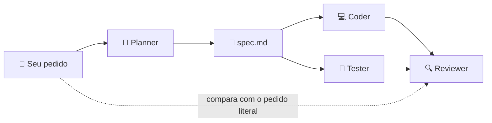
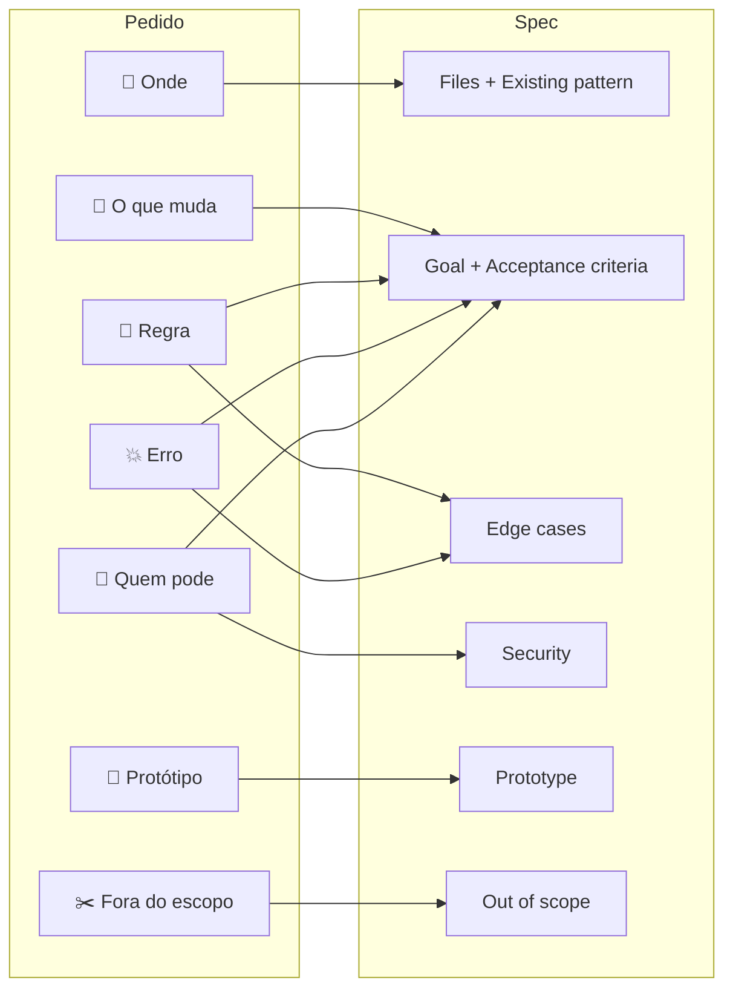
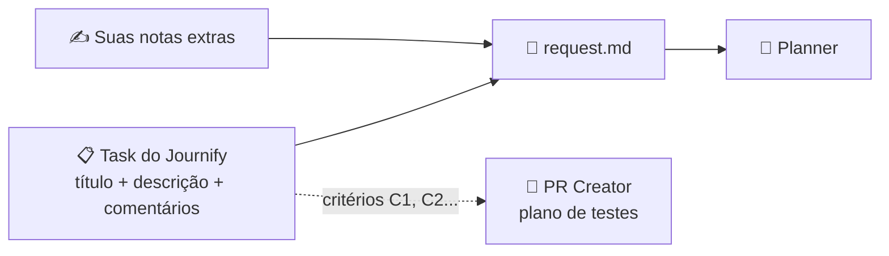

<div align="center">

# 🎯 Como escrever um bom pedido para o `/pipeline`

**Um guia prático para escrever pedidos que viram spec direto, sem rodadas de pergunta e sem retrabalho.**

| ⏱️ Leitura | 🎓 Nível | 🧠 Você vai aprender |
|:---:|:---:|:---:|
| 10 min | Iniciante | As 7 peças de um pedido, como montar um do zero e como evitar os erros mais comuns |

</div>

> [!TIP]
> **Resumo para quem tem pressa.** Um bom pedido diz **onde**, **o que muda**, **a regra**, **o erro** e **quem pode**, com números e mensagens exatas. Escreva cada trecho como se ele fosse virar um teste, porque vai.

---

## 🗺️ Trilha

| # | Etapa | O que você leva dela |
|:---:|---|---|
| 1 | [Por que o pedido importa](#1--por-que-o-pedido-importa) | Entender quem lê o seu pedido |
| 2 | [As 7 peças](#2--as-7-peças-de-um-bom-pedido) | O molde que serve para qualquer pedido |
| 3 | [Mão na massa](#3--mão-na-massa-do-vago-ao-específico) | Montar um pedido real, peça por peça |
| 4 | [Pedido pelo Journify](#4--pedido-por-task-do-journify) | Usar a task como prompt |
| 5 | [Treino](#5--treino) | Praticar com exercícios e gabarito |
| 6 | [Erros comuns](#6--erros-comuns) | O que trocar por o quê |
| 7 | [Perguntas do Planner](#7--respondendo-às-perguntas-do-planner) | Responder rápido e sem ambiguidade |
| 8 | [Checklist e cola](#8--checklist-e-cola-rápida) | Conferir antes de rodar |

---

## 1. 🧭 Por que o pedido importa

O pedido é a única coisa do run que vem de você. Todo o resto sai dele.



- O **Planner** transforma o pedido em spec, com critérios de aceite numerados.
- O **Coder** implementa o spec, e só o spec.
- O **Tester** escreve um teste para cada critério, copiando os valores esperados do spec.
- O **Reviewer** compara o resultado com o **pedido original**, não só com o spec.

> [!IMPORTANT]
> Um pedido vago tem dois finais possíveis. Ou o Planner para com várias perguntas, ou ele adivinha errado e o pipeline implementa o palpite errado com perfeição. O que não está escrito no pedido não vira teste.

---

## 2. 🧩 As 7 peças de um bom pedido

| | Peça | Pergunta que responde | Vira, no spec | Quando usar |
|:---:|---|---|---|:---:|
| 📍 | **Onde** | Qual rota, tela, endpoint ou arquivo? | Files to modify, Existing pattern | ✅ Sempre |
| 👀 | **O que muda** | O que fica diferente de forma que dá para ver ou medir? | Goal, Acceptance criteria | ✅ Sempre |
| 📏 | **Regra ou limite** | Qual o número, o formato, a condição? | Acceptance criteria, Edge cases | ✅ Sempre |
| 💥 | **Erro** | O que acontece quando dá errado? Status e mensagem? | Acceptance criteria, Edge cases | ✅ Sempre |
| 🔐 | **Quem pode** | Precisa estar logado? Qual papel? Só o dono? | Security, mais um critério por regra | ⚠️ Quase sempre |
| 🎨 | **Protótipo** | Tem Figma, print ou página de referência? | Prototype / design reference | 🖥️ Telas |
| ✂️ | **Fora do escopo** | O que parece fazer parte mas fica para depois? | Out of scope | 💡 Quando houver dúvida |



### 🧱 O molde

```text
/pipeline "<📍 onde>: <👀 o que muda>; <📏 regra ou limite>; <💥 o que acontece no erro>; <🔐 quem pode>; protótipo em <🎨 caminho>; fora do escopo <✂️ x>"
```

---

## 3. 🛠️ Mão na massa: do vago ao específico

Vamos partir de uma ideia solta e encaixar uma peça por vez.

### 🌱 Ponto de partida

```text
Quero que o usuário possa favoritar produtos.
```

> [!WARNING]
> Isso roda, mas o Planner vai parar e perguntar. Onde fica? Tem limite? Quem vê os favoritos? Cada pergunta é uma rodada a mais.

---

### Passo 1 · 📍 Onde &nbsp; `🟩⬜⬜⬜⬜⬜`

Nomeie a rota ou a tela **como ela existe no código**.

```diff
- favoritar produtos
+ POST /products/:id/favorite e DELETE /products/:id/favorite
```

### Passo 2 · 👀 O que muda &nbsp; `🟩🟩⬜⬜⬜⬜`

Descreva o **comportamento**, não a implementação.

| ❌ Implementação | ✅ Comportamento observável |
|---|---|
| "salva na tabela favorites" | "o produto passa a aparecer em `GET /users/me/favorites`, do mais recente para o mais antigo" |

### Passo 3 · 📏 Regra ou limite &nbsp; `🟩🟩🟩⬜⬜⬜`

Número, formato, condição. **Sem adjetivo.**

```diff
- não pode favoritar muitas vezes
+ favoritar duas vezes não duplica (responde 200); máximo de 100 por usuário
```

### Passo 4 · 💥 Erro &nbsp; `🟩🟩🟩🟩⬜⬜`

Status e corpo **exatos**. O Tester copia esse texto para dentro do teste.

```diff
- dar erro se não existir
+ produto inexistente dá 404 {error: 'product_not_found'}; acima de 100 dá 422 {error: 'favorites_limit'}
```

### Passo 5 · 🔐 Quem pode &nbsp; `🟩🟩🟩🟩🟩⬜`

É isso que faz o E2E testar **sem token** e **com o token de outro usuário**.

```diff
+ só usuário logado; cada um vê e mexe só nos próprios favoritos
```

### Passo 6 · ✂️ Fora do escopo &nbsp; `🟩🟩🟩🟩🟩🟩`

Se você sabe que alguém vai pensar nisso, diga que fica de fora.

```diff
+ fora do escopo o botão na tela (vem em outra task)
```

### 🏁 Resultado

```text
/pipeline "favoritos de produto: POST /products/:id/favorite e DELETE /products/:id/favorite; o produto passa a aparecer em GET /users/me/favorites, do mais recente para o mais antigo; favoritar duas vezes não duplica (responde 200); máximo de 100 por usuário; produto inexistente dá 404 {error: 'product_not_found'}, acima de 100 dá 422 {error: 'favorites_limit'}; só usuário logado, cada um vê e mexe só nos próprios favoritos; fora do escopo o botão na tela"
```

> [!NOTE]
> Ficou longo, e tudo bem. Cada trecho vira um critério de aceite que alguém vai testar, e nenhum deles precisou de pergunta.

<details>
<summary>🔎 <b>Veja como esse pedido vira critérios de aceite no spec</b></summary>

<br>

| Trecho do pedido | Critério que o Planner escreve |
|---|---|
| "aparece em GET /users/me/favorites, do mais recente para o mais antigo" | 1. Depois de `POST /products/42/favorite`, `GET /users/me/favorites` lista o produto 42 na primeira posição |
| "favoritar duas vezes não duplica (responde 200)" | 2. Um segundo `POST` no mesmo produto responde 200 e a lista continua com 1 item |
| "máximo de 100 por usuário" + "acima de 100 dá 422" | 3. Com 100 favoritos, o 101º responde 422 `{error: 'favorites_limit'}` |
| "produto inexistente dá 404" | 4. `POST /products/999999/favorite` responde 404 `{error: 'product_not_found'}` |
| "só usuário logado" | 5. Sem token, responde 401 |
| "cada um vê só os próprios" | 6. O usuário B não vê os favoritos do usuário A |

</details>

---

## 4. 📋 Pedido por task do Journify

Se a feature já está numa task, passe o ID ou o link.

```text
/pipeline IukG491JBKEkvjmeT8yg
```



> [!IMPORTANT]
> **A task é o prompt.** As mesmas 7 peças valem para ela. Escreva os critérios **numerados** na descrição da task, porque o PR Creator monta o plano de testes do robô a partir deles.

Quando a task não diz tudo, complete depois do ID.

```text
/pipeline IukG491JBKEkvjmeT8yg "o limite é 100 por usuário; produto inexistente dá 404 {error: 'product_not_found'}"
```

> [!TIP]
> Se você completa a mesma lacuna toda vez, corrija a **task**, não as notas. Assim o revisor de regras e o robô de testes também enxergam.

---

## 5. 🏋️ Treino

Tente resolver antes de abrir o gabarito.

### Exercício 1 · Qual peça falta?

```text
/pipeline "GET /orders/:id: devolve o pedido com os itens e o total; pedido inexistente dá 404 {error: 'order_not_found'}"
```

<details>
<summary>💡 Gabarito</summary>

<br>

Falta **🔐 Quem pode**. Do jeito que está, qualquer usuário logado lê o pedido de qualquer outro. Complete com:

```text
só o dono do pedido; pedido de outro usuário também dá 404 (não revela que existe)
```

</details>

### Exercício 2 · Melhore o pedido vago

```text
/pipeline "melhorar a busca de produtos"
```

<details>
<summary>💡 Gabarito</summary>

<br>

```text
/pipeline "GET /products?q=: busca por nome sem diferenciar maiúsculas nem acentos ('cafe' acha 'Café'); mínimo de 2 caracteres, com 1 caractere dá 400 {error: 'query_too_short'}; até 20 resultados ordenados por nome; rota pública; fora do escopo busca por categoria"
```

| Peça | Trecho |
|---|---|
| 📍 | `GET /products?q=` |
| 👀 | busca por nome sem diferenciar maiúsculas nem acentos |
| 📏 | mínimo de 2 caracteres, até 20 resultados, ordenados por nome |
| 💥 | 400 `{error: 'query_too_short'}` |
| 🔐 | rota pública |
| ✂️ | busca por categoria |

</details>

### Exercício 3 · Transforme a reclamação em bugfix

```text
/pipeline "o upload de foto tá quebrado"
```

<details>
<summary>💡 Gabarito</summary>

<br>

Bug pede **sintoma**, **onde acontece** e **comportamento certo**. Rode numa branch `bugfix/*`.

```text
/pipeline "corrigir: PATCH /users/me/avatar com PNG acima de 2 MB devolve 500; deve recusar com 413 {error: 'file_too_large'} antes de salvar; JPEG e PNG até 2 MB continuam funcionando"
```

O trecho "continuam funcionando" vira um teste de regressão.

</details>

### Exercício 4 · Tela com protótipo

```text
/pipeline "fazer a tela de login bonita igual o figma"
```

<details>
<summary>💡 Gabarito</summary>

<br>

```text
/pipeline "tela /login: campos e-mail e senha, botão Entrar desabilitado até os dois estarem preenchidos; no erro auth/invalid-credential mostrar 'E-mail ou senha incorretos' abaixo do formulário; sucesso redireciona para /dashboard; protótipo em docs/design/login.png; fora do escopo login com Google"
```

"Bonita igual o Figma" vira **🎨 protótipo em `docs/design/login.png`**. O E2E compara o estilo com ele.

</details>

---

## 6. 🚫 Erros comuns

| ❌ Em vez de | ✅ Escreva | 🤔 Por quê |
|---|---|---|
| "rápido", "bonito", "seguro" | "responde em menos de 300 ms", "botão #2563EB, raio 8px", "só o dono, 404 para outro" | Adjetivo não vira teste |
| "cria um service", "usa Redis" | O comportamento observável | O Planner escolhe a implementação seguindo o padrão do projeto |
| "mostra uma mensagem de erro" | `'E-mail ou senha incorretos'` | O Tester copia o texto exato |
| "etc", "e afins" | A lista completa | O que não está escrito não é testado |
| "faz X e também Y" | Dois runs | Cada feature com o seu spec, o seu review e o seu PR |
| "corrigir o login" | Sintoma + onde + comportamento certo | Sem sintoma não dá para provar que o bug existia |

---

## 7. 💬 Respondendo às perguntas do Planner

Mesmo um bom pedido pode deixar uma decisão em aberto. O Planner para e pergunta, normalmente com opções.

```text
1. FRETE num total abaixo de 15,00: (a) trava em 0  (b) rejeita com erro  (c) deixa negativo
2. Arredondamento em meio centavo: (a) comercial, 9,05  (b) ABNT 5891, 9,04
```

| ✅ Boa resposta | ❌ Resposta que gera outra pergunta |
|---|---|
| `1a, 2a` | "o que fizer mais sentido" |
| `1: rejeitar com 422 {error: 'coupon_exceeds_total'}` | "rejeita" (com qual status? qual mensagem?) |

> [!NOTE]
> A resposta vai para `## Decisions` no spec e vira critério de aceite. Ela vale tanto quanto o pedido.

> [!TIP]
> Se o Planner perguntou algo que você achava óbvio, o pedido deixou isso implícito. Da próxima vez, ponha no pedido. O `.pipeline/history/LOG.md` mostra quais perguntas se repetem.

---

## 8. ✅ Checklist e cola rápida

### Antes de rodar

- [ ] Estou numa branch `feature/*`, `bugfix/*`, `hotfix/*` ou `release/*`
- [ ] 📍 Nomeei a rota, a tela ou o arquivo como existe no código
- [ ] 👀 Cada comportamento dá para ver ou medir
- [ ] 📏 Limites têm número e formatos têm exemplo (`DD/MM/AAAA`, `(99) 99999-9999`)
- [ ] 💥 Erros têm status e mensagem exatos
- [ ] 🔐 Disse quem pode chamar ou ver
- [ ] 🎨 Apontei o protótipo, se é tela
- [ ] ✂️ É **uma** feature só

### 🧾 Cola

```text
/pipeline "<📍 onde>: <👀 o que muda>; <📏 regra>; <💥 erro com status e mensagem>; <🔐 quem pode>; protótipo em <🎨 caminho>; fora do escopo <✂️ x>"
```

| Tipo de pedido | Peças que não podem faltar |
|---|---|
| 🔌 Endpoint | 📍 👀 📏 💥 🔐 |
| 🖥️ Tela web ou app | 📍 👀 💥 🎨 |
| 🧮 Regra de domínio | 📍 (arquivo ou classe) 👀 📏 💥 |
| 🐛 Bugfix | Sintoma, 📍, comportamento certo |
| 🗄️ Campo novo com migration | Tipo, se é opcional, 📏 formato, 💥 |

<div align="center">

---

📚 Mais exemplos prontos em [Modelos de prompt](README.md#modelos-de-prompt) no README.

</div>
